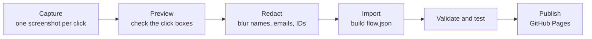

<div align="center">

# Demo Anything

### Turn any web app into a click-through walkthrough, with your agent.

**Show someone how a product works, one click at a time, without recording a video.**

[](https://github.com/vinal-2/demo-anything/actions/workflows/ci.yml)
[](https://vinal-2.github.io/demo-anything/)
[](skills/demo-anything/SKILL.md)
[](docs/getting-started.md)
[](LICENSE)

**[Live demos](https://vinal-2.github.io/demo-anything/) · [Guides](docs/getting-started.md) · [Agent skill](skills/demo-anything/SKILL.md)**

[Quick start](#quick-start) · [How it works](#how-it-works) · [Showcases](#showcases) · [FAQ](#faq) · [Documentation](#documentation)

<br />

<a href="https://vinal-2.github.io/demo-anything/?flow=example"></a>

</div>

---

## Quick start

### Set up your agent

1. Install [Claude Code](https://code.claude.com/docs/en/overview) and connect the
   [Claude in Chrome](https://code.claude.com/docs/en/chrome) extension.
2. Clone this repository and copy `skills/demo-anything/` into
   `~/.claude/skills/`.
3. Sign in to the app you want to demo in a Chrome profile with nothing else signed
   in. A sandbox or test tenant is best.

### Ask your agent

```text
Use the demo-anything skill. Build flow "settings-tour" named
"Find your notification settings" from https://app.example.com:
Home → Settings → Notifications → the Email alerts switch.
```

The agent walks the app read-only, captures each step, redacts anything
identifying, builds the flow and tests it. It stops at sign-in and MFA pages and
never clicks Save, Submit or Delete. See [docs/agent-workflow.md](docs/agent-workflow.md).

### Use the terminal

```bash
npm install
npm start                      # http://localhost:4173/?flow=example
npm run validate -- flows/my-flow
npm test
```

Every command is listed in [docs/getting-started.md](docs/getting-started.md#commands).

## How it works



- **Capture.** Screenshots go into `capture/raw/`, which is git-ignored and never
  served, so unredacted images cannot be published by accident.
- **Redact.** `redact.json` must list every screenshot, and the tool refuses to skip
  one.
- **Play.** The player is plain HTML, CSS and JavaScript with no build step. It
  works with the keyboard and screen readers, and on any static host.
- **Check.** CI blocks raw captures, scans for secrets, validates every flow and
  plays each one from cover to end card in a real browser.

## Showcases

| Demo | What it shows |
| --- | --- |
| [Example: turn on email alerts](https://vinal-2.github.io/demo-anything/?flow=example) | A three-step tour of a fictional admin app. Start here. |
| Setting up and onboarding a device in Defender for Endpoint | Coming soon: built by the agent from a sandbox tenant. |

Made a demo? Open a pull request; see [CONTRIBUTING.md](CONTRIBUTING.md).

## FAQ

**Why screenshots instead of a video?** People go at their own pace, click the real
control, and can find a step again. Screenshots are also easy to redact and update.

**Does the agent change anything in my app?** No. It is told to stay read-only:
it screenshots buttons like Save or Delete so the demo can point at them, but never
clicks them. Use a sandbox anyway.

**Can I use it without an agent?** Yes. Capture screenshots yourself and follow
[docs/getting-started.md](docs/getting-started.md).

**Where can I host it?** Anywhere that serves static files. GitHub Pages is set up
already; see [docs/publishing.md](docs/publishing.md).

## Documentation

- [Getting started](docs/getting-started.md): install, make a flow by hand, commands
- [Build flows with an agent](docs/agent-workflow.md): the skill and what it does
- [Redaction](docs/redaction.md): what to hide and how
- [Flow format](docs/flow-format.md): `steps.json`, `flow.json` and validation rules
- [Publishing](docs/publishing.md): GitHub Pages and other hosts

## Disclaimer

Independent project, not affiliated with any vendor shown in a demo. Only capture
systems you are allowed to use, and redact before you publish. See
[DISCLAIMER.md](DISCLAIMER.md).

## Contributing

Demos, fixes and ideas are welcome. Read [CONTRIBUTING.md](CONTRIBUTING.md); for
security problems or leaked data, use [SECURITY.md](SECURITY.md).

## Licence

[MIT](LICENSE)
