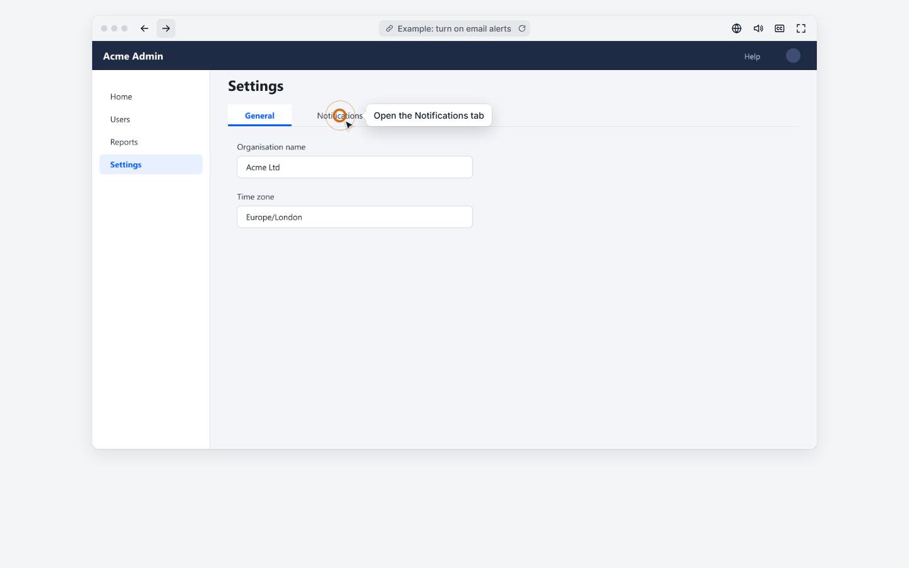
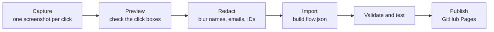

<div align="center">

# Demo Anything

### Turn any web app into a click-through walkthrough, with your agent.

**Show someone how a product works, one click at a time: narration, captions and a guided cursor, without recording a video.**

[](https://github.com/vinal-2/demo-anything/actions/workflows/ci.yml)
[](https://vinal-2.github.io/demo-anything/)
[](skills/demo-anything/SKILL.md)
[](docs/getting-started.md)
[](LICENSE)

**[Live demos](https://vinal-2.github.io/demo-anything/) · [Guides](docs/getting-started.md) · [Agent skill](skills/demo-anything/SKILL.md)**

[Quick start](#quick-start) · [How it works](#how-it-works) · [Player](#whats-in-the-player) · [Showcases](#showcases) · [FAQ](#faq) · [Documentation](#documentation) · [Star history](#star-history)

<br />

<a href="https://vinal-2.github.io/demo-anything/?flow=example"></a>

</div>

---

## Quick start

### Set up your agent

1. Install [Claude Code](https://code.claude.com/docs/en/overview) and connect the
   [Claude in Chrome](https://code.claude.com/docs/en/chrome) extension.
2. Clone this repository and copy `skills/demo-anything/` into
   `~/.claude/skills/`.
3. Sign in to the app you want to demo in a Chrome profile with nothing else signed
   in. A sandbox or test tenant is best.

### Ask your agent

```text
Use the demo-anything skill. Build flow "settings-tour" named
"Find your notification settings" from https://app.example.com:
Home → Settings → Notifications → the Email alerts switch.
```

The agent walks the app read-only, captures each step, redacts anything
identifying, builds the flow and tests it. It stops at sign-in and MFA pages and
never clicks Save, Submit or Delete. See [docs/agent-workflow.md](docs/agent-workflow.md).

### Use the terminal

```bash
npm install
npm start                      # http://localhost:4173/?flow=example
                               # add &edit to place hotspots by clicking
npm run validate -- flows/my-flow
npm test
```

Every command is listed in [docs/getting-started.md](docs/getting-started.md#commands).

## How it works



- **Capture.** Screenshots go into `capture/raw/`, which is git-ignored and never
  served, so unredacted images cannot be published by accident.
- **Redact.** `redact.json` must list every screenshot, and the tool refuses to skip
  one.
- **Play.** The player is plain HTML, CSS and JavaScript with no build step, so it
  runs on any static host.
- **Check.** CI blocks raw captures, scans for secrets, validates every flow and
  plays each one from cover to end card in a real browser.

## What's in the player

| Feature | What it does |
| --- | --- |
| Narration and captions | Each step is read aloud by the browser, or by recorded Azure or ElevenLabs audio, with word-by-word captions |
| Guided cursor and hotspots | A cursor glides to a pulsing hotspot; the flow waits until the viewer clicks the right place |
| Video steps | Short clips (WebM or MP4) for transitions, played with narration |
| Controls | Play and pause, progress segments to jump between steps, 1× to 2× speed, sound, captions and full screen |
| Authoring mode | Open `?flow=<id>&edit` to place hotspots by clicking and edit narration, then export `flow.json` |
| Embedding | `?embed` for iframes, with step and completion events for learning platforms |
| Accessible | Works with the keyboard alone and with screen readers, and fits phone, tablet and desktop screens |

See [docs/player.md](docs/player.md) for the controls, the editor, voice and embedding.

## Showcases

| Demo | What it shows |
| --- | --- |
| [Example: turn on email alerts](https://vinal-2.github.io/demo-anything/?flow=example) | A three-step tour of a fictional admin app. Start here. |

Made a demo? Open a pull request; see [CONTRIBUTING.md](CONTRIBUTING.md).

## FAQ

<details>
<summary><strong>Which agents can use Demo Anything?</strong></summary>

The skill is written for [Claude Code](https://code.claude.com/docs/en/overview)
with [Claude in Chrome](https://code.claude.com/docs/en/chrome), which gives the
agent your real browser. The skill itself is a plain Markdown file and the tools
are ordinary Node.js scripts, so any agent that can drive a browser and run
commands can follow it.
</details>

<details>
<summary><strong>Do I need an agent or Claude in Chrome?</strong></summary>

No. They save time, but you can take the screenshots yourself and run the same
tools. See [docs/getting-started.md](docs/getting-started.md#make-a-flow-by-hand).
</details>

<details>
<summary><strong>What does installing the skill do?</strong></summary>

It copies one instruction file, `SKILL.md`, into your agent's skills folder. No
code runs when you install it. When you ask for a demo, the agent reads the file
and follows its steps: size the window, capture, redact, import, validate and test.
</details>

<details>
<summary><strong>Does the agent change anything in my app?</strong></summary>

It is told not to. It never clicks Save, Submit, Apply, Delete, toggles or anything
that changes data; it screenshots those controls so the demo can point at them.
It stops at sign-in and MFA pages. Use a sandbox or test tenant anyway.
</details>

<details>
<summary><strong>Does Demo Anything upload my screenshots?</strong></summary>

The tools run on your computer and send nothing anywhere. Raw screenshots stay in
`capture/`, which is git-ignored and never served. Only what you commit to
`flows/` is published, and only if you push it. If an agent builds the demo, it
sees the screenshots as part of its normal work, so capture a sandbox, not
production.
</details>

<details>
<summary><strong>How do I keep sensitive data out?</strong></summary>

Redact before you import: `redact.json` must list every screenshot, so none is
skipped. Then look at every cleaned image yourself. CI blocks anything under
`capture/` and scans for secrets. See [docs/redaction.md](docs/redaction.md).
</details>

<details>
<summary><strong>Why screenshots instead of a video?</strong></summary>

People go at their own pace, click the real control, and can find a step again.
Screenshots are also easy to redact, check and update when the product changes.
</details>

<details>
<summary><strong>Where can I host it?</strong></summary>

Anywhere that serves static files. GitHub Pages is set up already; see
[docs/publishing.md](docs/publishing.md).
</details>

<details>
<summary><strong>What should I do if I hit a bug?</strong></summary>

Open an [issue](https://github.com/vinal-2/demo-anything/issues/new/choose) with
the flow or command and what you saw. For a security problem or leaked data, report
it privately; see [SECURITY.md](SECURITY.md).
</details>

## Documentation

- [Getting started](docs/getting-started.md): install, make a flow by hand, commands
- [The player](docs/player.md): controls, authoring mode, voice and embedding
- [Build flows with an agent](docs/agent-workflow.md): the skill and what it does
- [Redaction](docs/redaction.md): what to hide and how
- [Flow format](docs/flow-format.md): `steps.json`, `flow.json` and validation rules
- [Publishing](docs/publishing.md): GitHub Pages and other hosts

## Star history

<a href="https://www.star-history.com/#vinal-2/demo-anything&Date">
  <picture>
    <source media="(prefers-color-scheme: dark)" srcset="https://api.star-history.com/svg?repos=vinal-2/demo-anything&type=Date&theme=dark" />
    
  </picture>
</a>

If Demo Anything helps you, a star helps other people find it.

## Disclaimer

See [DISCLAIMER.md](DISCLAIMER.md) for responsible-use guidance.

Demo Anything is for training, documentation, onboarding and showing software you
own or are authorised to use. Capture only systems you have permission to access,
prefer a sandbox or test tenant, and redact everything that identifies a person or
organisation before you publish.

This position covers every version and copy of the project, whoever runs it and
wherever it is hosted; each copy keeps its licences.

## Contributing

We'd love your help. Open an issue to report a bug or suggest a demo, or send a
pull request to improve the code, docs or flows.

See [CONTRIBUTING.md](CONTRIBUTING.md) for setup and checks,
[docs/flow-format.md](docs/flow-format.md) for the data the tools expect, and
[SECURITY.md](SECURITY.md) to report a security problem or leaked data privately.

## Licence

[MIT](LICENSE)

Code written for Demo Anything is licensed under MIT. Third-party material keeps
its own licences and copyright notices; see
[THIRD_PARTY_NOTICES.md](THIRD_PARTY_NOTICES.md).

Screenshots in a demo show other companies' products. Their names, logos and
interfaces belong to their owners, and a demo grants no right to use those
products. You need your own valid licence or subscription for any product you
capture, and you must follow its terms, including any limits on screenshots,
automation or sharing. Demo Anything is not affiliated with or endorsed by those
vendors. This guidance does not change the MIT licence or any third-party licence.
